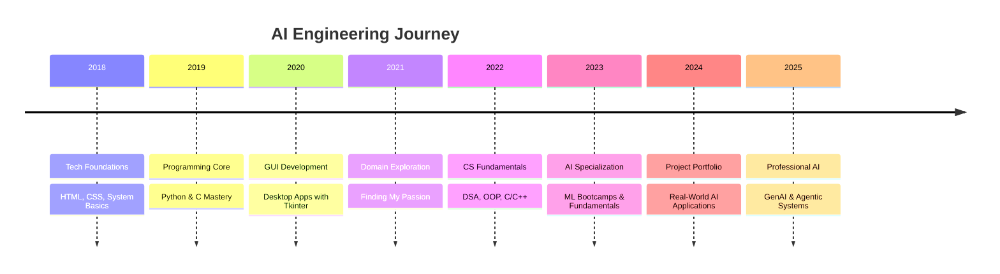

#  Mahesh Ketam | AI Innovator & Machine Learning Maestro

  <picture>
    <source media="(max-width: 600px)" srcset="https://capsule-render.vercel.app/api?type=waving&color=gradient&customColorList=0,2,2,5,30&height=150&section=header&text=MAHESH%20KETAM&fontSize=40&animation=fadeIn">
    
  </picture>
  
  

    
    
    
  

##  Mission Statement

> **Transforming complex data into intelligent solutions, one model at a time. Committed to pushing the boundaries of AI and machine learning to solve real-world challenges.**

---

##  About Me

Hi, I'm **MAHESH KETAM** — an aspiring AI Engineer passionate about solving real-world problems through Machine Learning, Deep Learning, and Next-Gen AI systems.

I love building projects that merge Computer Vision, Natural Language Processing (NLP), and Agentic AI, leveraging tools like LangChain, LangGraph, and LLMs to create intelligent and autonomous applications.

###  Education
- **Bachelor's in Computer Science** - Jayamukhi Institute of Technological Sciences
- **Applied AI Lab** - World Quant University
- **#100DaysOfAI** - 100 School

---

##  Quick Glimpse

|  Mission |  At a Glance |
|------------|----------------|
| Transforming complex data into intelligent solutions, bridging the gap between artificial intelligence and real-world challenges. |  3+ Years in AI/ML  Computer Science Graduate  Full-Stack AI Enthusiast |

---

###  Skill Proficiency

| Skill Category        | Proficiency          | Highlights                                                                    |
| --------------------- | -------------------- | ----------------------------------------------------------------------------- |
| **Machine Learning**  | ████████████████ 95% | Supervised & Unsupervised Learning, Model Evaluation, Feature Engineering     |
| **Deep Learning**     | ███████████████ 90%  | CNNs, RNNs, ANN, Transfer Learning, PyTorch, TensorFlow                       |
| **NLP & LLMs**        | ███████████████ 90%  | Transformers, LangChain, RAG, Embeddings, Prompt Engineering                  |
| **Data Science**      | ██████████████ 85%   | EDA, Statistical Analysis, Data Cleaning, Visualization (Matplotlib, Seaborn) |
| **Agentic AI**        | ████████████ 80%     | LangGraph, Reflection Agents, Custom Toolchains                               |
| **AI Deployment**     | ████████████ 75%     | FastAPI, Docker, Hugging Face Spaces, Streamlit                               |
| **MLOps & Tools**     | ███████████ 70%      | Git, DVC, MLflow (basic), CI/CD                                               |
| **Web Search & APIs** | ███████████ 70%      | Google Search API, SerpAPI, REST APIs                                         |
| **Soft Skills**       | ██████████ 65%       | Communication, Teamwork, Documentation, Learning Agility                      |

---

##  Tech Stack

  

---

##  My Journey

---

##  Professional Experience

###  AI Engineer Intern | WitsenseAI
**January 2025 - June 2025**

-  Exploring state-of-the-art AI techniques and tools
-  Hands-on experience with GenAI, API development, and deployment
-  Transitioning to Agentic AI (LangGraph, LangChain)

###  Data Science & AI/ML Intern | YBI Foundation
**March 2023 - September 2023**

-  Achieved 100% accuracy in iris classification
-  Developed wine quality prediction model (90% accuracy)
-  Conducted comprehensive model evaluations

---

##  Featured Projects

| Project | Description | Tech Stack | Link |
|---------|-------------|------------|------|
| **Stock News Summarizer** | Latest summarized news for companies | Python, LangChain, RAG | [View →](https://github.com/Nirikshan95/stock-news-summarizer) |
| **Product Review Analyzer** | AI-powered review analysis with sentiment | Python, LangChain, Pydantic | [View →](https://github.com/Nirikshan95/Product-Review-Analyzer) |
| **AskMyYouTube** | Q&A from YouTube transcripts using RAG | Python, LangChain, Streamlit | [View →](https://github.com/Nirikshan95/AskMyYouTube) |
| **LinkedIn Post Polisher** | Agent system for post generation & refinement | Python, LangGraph | [View →](https://github.com/Nirikshan95/LinkedIn-Post-Polisher) |
| **Quiz Generator** | AI quiz generation from text | Python, LangChain | [View →](https://github.com/Nirikshan95/Quiz-Generator-from-Text) |

---

##  Notable Repositories

-  **[VettIQ - AI Startup Validator](https://github.com/Nirikshan95/VettIQ)**  
  `LangGraph` · `Streamlit` · `FastAPI` · `DeepSeek`

-  **[Product Review Analyzer](https://github.com/Nirikshan95/Product-Review-Analyzer)**  
  `LangChain` · `LLM` · `Pydantic`

-  **[Defective Products Detection](https://github.com/Nirikshan95/Defective-Products-Detection)**  
  `CNN` · `Deep Learning` · `Computer Vision`

-  **[Quality Prediction in Mining Process](https://github.com/Nirikshan95/Quality-Prediction-in-a-Mining-Process)**  
  `Machine Learning` · `Scikit-Learn` · `pandas`

---

##  GitHub Analytics

  
  
  

---

##  Achievements & Certifications

| Achievement | Description | Year |
|-------------|-------------|------|
|  **#100DaysOfAI Challenge** | Completed intensive 100-day AI learning marathon | 2024 |
|  **Pandas Bootcamp** | Data analysis mastery certification | 2024 |
|  **ML Internships** | Successfully completed multiple internships | 2024-25 |
|  **Portfolio Launch** | #100DaysOfAI challenge portfolio website | 2024 |
|  **AI 'Zero to Hero' Course** | Comprehensive course on Teachable.com | Ongoing |
|  **Applied AI Lab** | World Quant University hands-on program | Ongoing |

---

##  Current Focus

  

**Learning Areas:**
-  Advanced AI techniques and emerging technologies
-  Deep learning and ML architectures
-  Agentic AI with LangGraph & LangChain
-  AI research and innovative developments

---

##  Philosophy

> *"In the world of AI, every line of code is a step towards understanding intelligence itself."*  
> — **Mahesh Ketam**

---

##  Let's Connect!

  
**Interested in AI, machine learning, or collaborative innovation?**  
**I'm always excited to network and explore groundbreaking ideas!**

 

---

  <picture>
    <source media="(max-width: 600px)" srcset="https://capsule-render.vercel.app/api?type=waving&color=gradient&customColorList=0,2,2,5,30&height=80&section=footer">
    
  </picture>
  
  ** Thank you for visiting! Stay curious, keep learning! **

