  

  

  

  

  

  

 

<a href="https://github.com/Nirikshan95/stock-news-summarizer">Stock News Summarizer</a> ·
<a href="https://github.com/Nirikshan95/Product-Review-Analyzer">Product Review Analyzer</a> ·
<a href="https://github.com/Nirikshan95/AskMyYouTube">AskMyYouTube</a> ·
<a href="https://github.com/Nirikshan95/LinkedIn-Post-Polisher">LinkedIn Post Polisher</a> ·
<a href="https://github.com/Nirikshan95/Quiz-Generator-from-Text">Quiz Generator</a> ·
<a href="https://github.com/Nirikshan95/VettIQ">VettIQ</a> ·
<a href="https://github.com/Nirikshan95/Defective-Products-Detection">Defective Products Detection</a> ·
<a href="https://github.com/Nirikshan95/Quality-Prediction-in-a-Mining-Process">Quality Prediction in a Mining Process</a>

  

  

  

  

  

